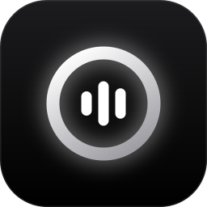
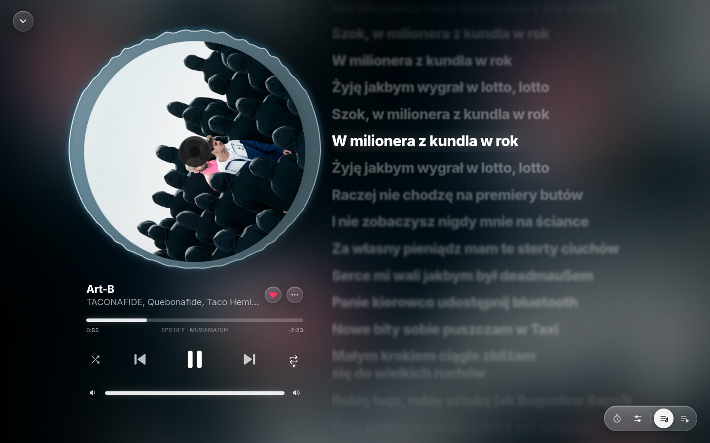
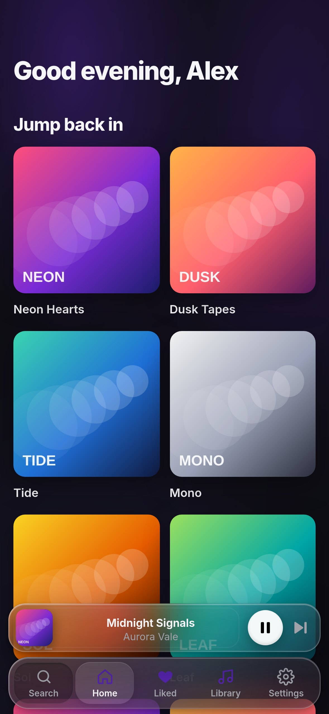
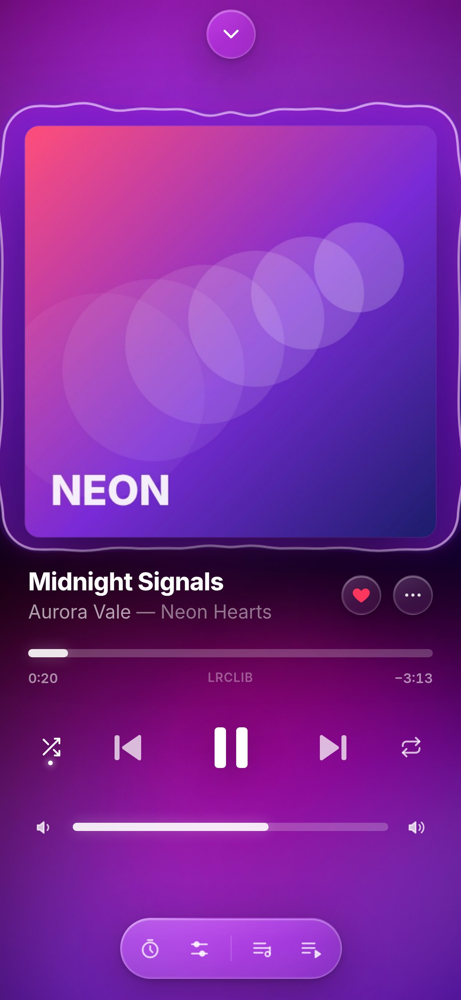
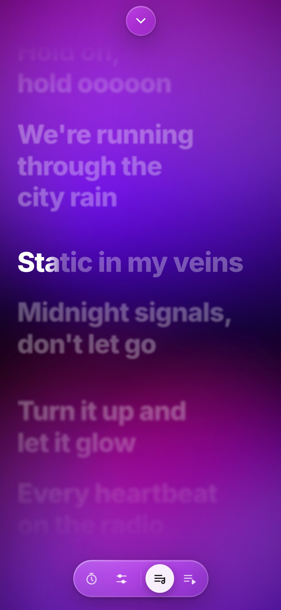

<div align="center">



# Afterglow

**A beautiful Spotify player with live, word-by-word lyrics.**
Liquid glass, album-art colors and a Now Playing screen that feels like Apple Music.

[](https://github.com/misalovesjapuszko/afterglow/releases/latest)
[](https://discord.gg/SPbcMXNERD)
[](https://misalovesjapuszko.github.io/afterglow/)

**Windows · Linux · iPhone & iPad**



</div>

## Features

- **Synced lyrics** that light up word by word: Spotify's own lyrics first, then LRCLIB
- **Album-art colors**: the whole app picks up the colors of the song that's playing
- **Liquid glass** design, with native iOS 26 Liquid Glass bars on iPhone
- **Smooth everything**: 3D cover transitions between songs, spring animations, a sound ring that moves with the music (Linux)
- Home, search, liked songs, playlists, albums, artists, queue
- **Plugins and themes**: plain JavaScript and CSS files, see [PLUGINS.md](PLUGINS.md)
- **Tiny**: about 8 MB. It uses your system's web engine instead of shipping Chromium

<p align="center">
  
  
  
</p>

## Download

Get the newest version from **[Releases](https://github.com/misalovesjapuszko/afterglow/releases/latest)**.

| System | File | Notes |
| --- | --- | --- |
| Windows 10 / 11 | `Afterglow_x.y.z_x64-setup.exe` | `arm64` build for Snapdragon laptops. `.msi` also available |
| Ubuntu, Debian, Mint, Pop!_OS | `.deb` | `sudo apt install ./Afterglow_*.deb` |
| Fedora, openSUSE, RHEL | `.rpm` | `sudo dnf install ./Afterglow-*.rpm` |
| Any Linux (2022 or newer) | `.AppImage` | `chmod +x` it and run |
| **Any** Linux (old, musl, immutable…) | `.flatpak` | `flatpak install Afterglow_linux_x64.flatpak` (no tray icon or sound ring in the sandbox) |
| Arch & others | `.tar.gz` | Just the program. Needs `webkit2gtk-4.1` |
| iPhone / iPad (iOS 15+) | `Afterglow-iOS-unsigned.ipa` | Sideload it with SideStore, AltStore, Sideloadly or a signing tool of your choice |

Every Linux file comes in `x64` and `arm64`.

## Getting started

You need **Spotify Premium**.

1. Open Afterglow and press **Sign in with browser** (on iPhone and iPad: **Sign in with Spotify**).
2. Your browser opens Spotify's page. If you're already logged in to Spotify there, just press Agree. That's it.

Prefer not to use your browser? **Sign in here instead** opens Spotify's login inside Afterglow.

If sign-in ever stops working, Afterglow can use your own free Spotify developer app instead. The app walks you through it step by step (about 3 minutes).

### How music plays

| System | What plays the sound |
| --- | --- |
| Windows | Afterglow itself (Spotify's official Web Playback SDK) |
| Linux | Afterglow itself through Spotify's official Soloist player (add a free key in Settings), or control any of your Spotify devices |
| iPhone / iPad | The Spotify app. Afterglow is the beautiful remote and lyrics screen |

## Keyboard

| Key | Action |
| --- | --- |
| Space | Play / pause |
| ← → | Seek 5 s |
| Ctrl + ← → | Previous / next |
| Ctrl + ↑ ↓ | Volume |
| L | Lyrics |
| Ctrl + K | Search |
| Esc | Close |

## Build it yourself

You need [Rust](https://rustup.rs) and the [Tauri prerequisites](https://v2.tauri.app/start/prerequisites/).

```sh
cargo install tauri-cli --version "^2"
cd src-tauri
cargo tauri build              # Windows / Linux
cargo tauri ios build          # iOS (on a Mac)
```

GitHub Actions builds every platform on each push. Pushing a `v*` tag creates a draft release with all the files ([`.github/workflows`](.github/workflows)).

## License

Afterglow is **source-available**: you can read the code, build it and change it for yourself, and plugins and themes are yours to share. Publishing modified versions or re-uploading builds is not allowed without permission. See [LICENSE](LICENSE).

## Community

Questions, ideas, themes, bugs, or just to see my other projects: **[join the Discord](https://discord.gg/SPbcMXNERD)**.

## Disclaimer

Afterglow is an unofficial app. It is not made by, endorsed by or affiliated with Spotify. Spotify is a trademark of Spotify AB. You need your own Spotify Premium account, and music always comes from Spotify.
